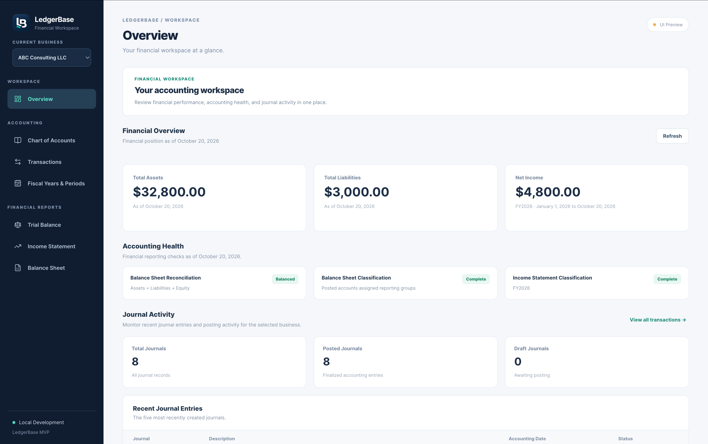
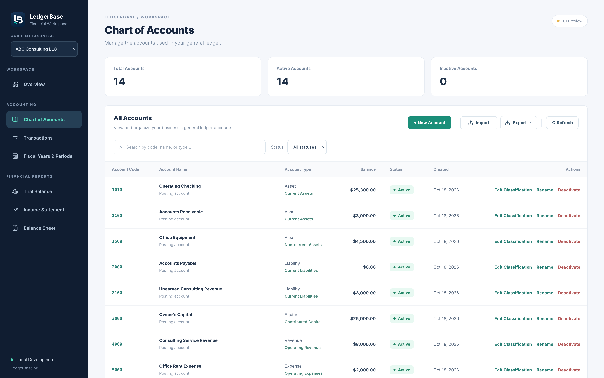
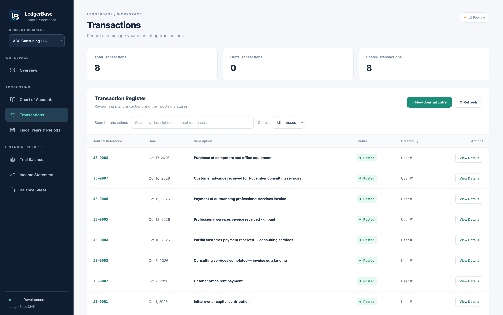
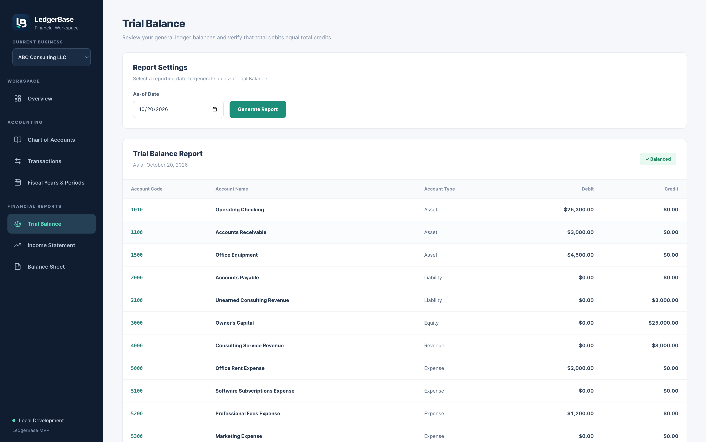
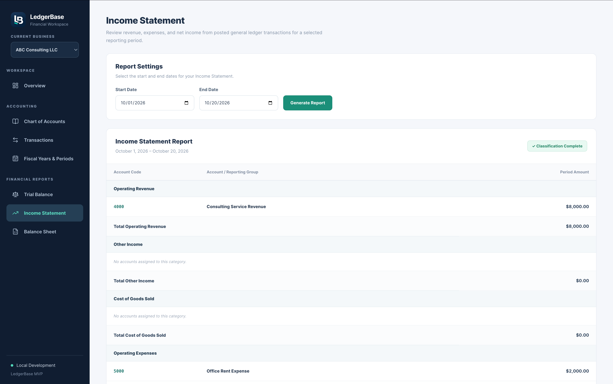
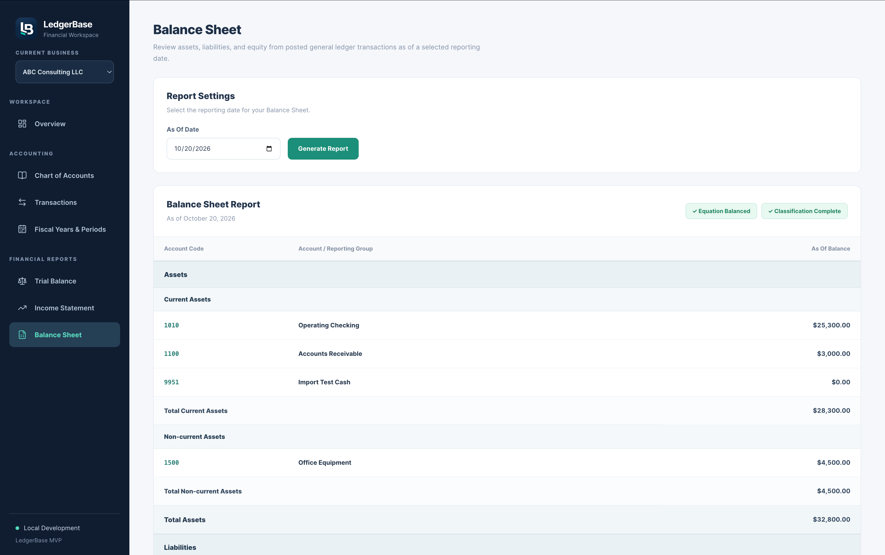

# LedgerBase

LedgerBase is a full-stack financial accounting platform built with
**Java, Spring Boot, React, TypeScript, MyBatis, and PostgreSQL**.

The project focuses on reliable financial transaction processing,
double-entry bookkeeping, general ledger management, and
database-backed financial reporting.

LedgerBase is designed as a backend-focused full-stack portfolio
project demonstrating:

- RESTful API development with Spring Boot.
- Layered backend architecture and business logic.
- Relational database design with PostgreSQL.
- Transactional financial data processing.
- Double-entry bookkeeping and accounting integrity.
- Database migrations with Flyway.
- React and TypeScript frontend development.
- End-to-end accounting workflow validation.

The application is currently under active development.

---

## Screenshots & Demo

LedgerBase provides a React-based accounting workspace
for managing financial records, processing journal entries,
and generating financial statements.

The screenshots below use the fictional demonstration
business **ABC Consulting LLC** and its October 2026
accounting transactions.

### Financial Dashboard

The Overview dashboard displays financial performance,
accounting health indicators, and recent journal activity
using data retrieved from the backend.



### Accounting Workflows

| Chart of Accounts | Journal Transactions |
|---|---|
|  |  |
| Account management, reporting classifications, hierarchy, and CSV/XLSX import/export. | Business-specific journal references, transaction statuses, and double-entry posting workflows. |

### Financial Reporting

LedgerBase generates a Trial Balance, Income Statement,
and Balance Sheet from posted ledger entries.

<details>
<summary><strong>View Financial Report Screenshots</strong></summary>

#### Trial Balance



#### Income Statement



#### Balance Sheet



</details>

### Accounting Demonstration

The ABC Consulting LLC scenario includes eight posted
journal entries covering capital contributions, expenses,
revenue recognition, receivables, payables, customer
advances, and fixed-asset purchases.

The documented demonstration verifies:

- Equal Trial Balance debit and credit totals.
- Revenue and expense recognition.
- Net Income of $4,800.00.
- Balanced total assets of $32,800.00.
- Balance Sheet reconciliation with a $0.00 difference.

**[View the Complete Accounting Demonstration](docs/accounting-demo.md)**

The demonstration data is stored in the local development
database and is not automatically seeded when cloning
the repository.

---


## Tech Stack

| Layer | Technologies |
|---|---|
| Frontend | React, TypeScript, Vite, Axios |
| Backend | Java 25, Spring Boot, Spring Cloud Gateway, REST APIs |
| Database Access | MyBatis, Spring JDBC |
| Primary Database | PostgreSQL 17 |
| Database Replication | PostgreSQL WAL Streaming Replication |
| Database Migrations | Flyway |
| Distributed Caching | Redis Cluster, Spring Data Redis, Lettuce |
| Asynchronous Messaging | Apache Kafka, Transactional Outbox, Idempotent Consumer |
| Authentication and Authorization | JWT, Business-Scoped RBAC |
| Development Infrastructure | Docker, Docker Compose |
| Build Tools | Maven, npm |
| Testing | JUnit, Mockito, Spring Boot Integration Tests |
| Version Control | Git, GitHub |

---

## Architecture

For a detailed explanation of the application layers,
accounting workflows, and database architecture, see
the [System Architecture Guide](docs/architecture.md).

LedgerBase follows a layered full-stack architecture.

```text
                 React + TypeScript
                         |
                         v
                Spring Cloud Gateway
                       :8081
                         |
             +-----------+-----------+
             |                       |
             v                       v
      Accounting Core         Reporting Service
          :8080                    :8082
             |                       |
             v                       +----> Redis Cluster
      PostgreSQL Primary                  (6 nodes)
             |                       |
             |                       v
             +--------------> PostgreSQL Replica
             |                       (read-only)
             |
             v
      Transactional Outbox
             |
             v
       Kafka Publisher
             |
             v
        Apache Kafka
             |
             v
       Kafka Consumer
             |
             v
      PostgreSQL Inbox
```

The application uses Spring Cloud Gateway as its API entry point.

Most accounting API requests are routed to Accounting Core.
Trial Balance read requests are handled by the independent
Reporting Service, which uses a PostgreSQL streaming replica
and Redis Cluster caching.

Accounting Core remains responsible for authoritative
financial transaction processing.

Committed financial events are persisted through a PostgreSQL
transactional outbox, published asynchronously to Apache Kafka,
and consumed using a durable, idempotent PostgreSQL inbox.

The Reporting Service also validates authentication and
business access through Accounting Core.

### Frontend

The React frontend provides user interfaces for managing
financial data and interacting with the accounting system.

It handles:

- Business selection.
- User input and form validation.
- Chart of Accounts management.
- Journal entry creation and review.
- Transaction posting workflows.
- Financial statement presentation.
- Loading, error, and success states.

The frontend communicates with the Spring Boot backend
through REST APIs.

### Backend

The Spring Boot backend implements accounting business
logic and validates financial operations.

Responsibilities include:

- Processing REST API requests.
- Validating journal entries.
- Managing transaction lifecycle states.
- Enforcing double-entry bookkeeping rules.
- Coordinating database transactions.
- Retrieving general ledger and reporting data.
- Applying accounting and business-level constraints.

### Database

PostgreSQL stores the application's financial records.

The database supports:

- Relational integrity and foreign key constraints.
- Business-scoped financial data.
- Financial transaction and ledger entry records.
- Database-level protection of posted transactions.
- Business-specific journal numbering.
- Audit records.
- Accounting and reporting structures.

Flyway manages versioned database schema migrations.

MyBatis maps Java backend operations to SQL statements.

---

## Kafka Transactional Outbox and Idempotent Consumer

LedgerBase uses Apache Kafka to support asynchronous
financial event processing without coupling financial
posting to broker availability.

### Architecture

1. Accounting Core posts a financial transaction.
2. PostgreSQL atomically persists the posting,
   audit record, reporting revision, and outbox event.
3. The outbox publisher claims committed events using
   `FOR UPDATE SKIP LOCKED`.
4. The publisher sends events to Apache Kafka.
5. A successful Kafka acknowledgment causes the event
   to be marked `PUBLISHED` in PostgreSQL.
6. The Kafka consumer validates incoming events and
   records processing receipts in a PostgreSQL inbox.
7. The consumer acknowledges Kafka only after the
   database processing transaction commits.

### Local Kafka Setup

Start the broker alongside the existing infrastructure:

```bash
docker compose -f docker-compose.yml \
  -f docker-compose.kafka.yml \
  up -d kafka
```

Create the financial event topic if it does not exist:

```bash
docker exec ledgerbase-kafka \
  /opt/kafka/bin/kafka-topics.sh \
  --bootstrap-server localhost:19092 \
  --create \
  --if-not-exists \
  --topic ledgerbase.transaction-posted.v1 \
  --partitions 3 \
  --replication-factor 1
```

Start Accounting Core with Kafka publishing and
consumption enabled:

```bash
mvn -f backend/pom.xml spring-boot:run \
  -Dspring-boot.run.profiles=kafka-outbox
```

Kafka publishing and consumption are opt-in and
disabled during normal backend test runs.

### Delivery and Idempotency

LedgerBase implements at-least-once event delivery.

The PostgreSQL outbox preserves events if Kafka
becomes unavailable. Failed publication attempts
are retried using exponential backoff.

Outbox claims expire so abandoned events can be
reclaimed after publisher failures.

Kafka may deliver the same event more than once.
The consumer uses a PostgreSQL inbox with a unique
`(consumer_name, event_id)` key to prevent duplicate
database processing for the same logical consumer.

The consumer does not repost financial transactions
or modify authoritative ledger balances.

### Reliability Testing

The backend test suite covers:

- Atomic financial posting and outbox recording.
- Duplicate outbox event prevention.
- Financial posting rollback on outbox insertion failure.
- Kafka publisher acknowledgment and retry handling.
- Expired publisher claim recovery.
- Consumer event-ID deduplication.
- Consumer acknowledgment on successful processing.
- Unacknowledged messages when processing fails.
- Rejection of events referencing DRAFT transactions.

Manual integration testing additionally verified
Kafka broker outage retries and automatic publication
after the broker recovered.

### Development Limitations

The local Kafka environment uses one KRaft broker,
replication factor 1, and PLAINTEXT listeners.

It is not a production high-availability deployment.

Kafka delivery is at least once, not globally
exactly once. Producer idempotence does not remove
the need for consumer deduplication.

The consumer's retry configuration may block a
partition when a message cannot be processed.
Production deployment would require additional
authentication, transport security, monitoring,
failure classification, and dead-letter handling.

The `earliest` offset reset policy applies when
the consumer group has no committed offsets.
Existing groups resume from their committed offsets.

---

## Implemented Features

### 1. Business and Accounting Structure

LedgerBase supports business-scoped financial records.

Accounting data is associated with a specific business,
allowing the application to maintain separate financial
records for different businesses.

Implemented accounting structures include:

- Businesses and related financial data.
- Fiscal years.
- Accounting periods.
- General ledger accounts.
- Financial transactions.
- Ledger entries.
- Reporting classifications.

LedgerBase implements JWT-based authentication and 
business-scoped role-based access control to enforce 
authorized financial operations. Additional security 
hardening is required for production deployment.

### 2. Chart of Accounts

Users can manage a business's general ledger accounts.

Features include:

- Create general ledger accounts.
- Assign customizable account codes.
- Classify accounts as Asset, Liability, Equity,
  Revenue, or Expense.
- Organize accounts using accounting reporting groups.
- View, search, and filter accounts.
- Update supported account information.
- Deactivate accounts while retaining financial history.
- Display account statistics and operation feedback.

Account classifications support financial reporting
and the aggregation of ledger balances.

### 3. Double-Entry Transaction Processing

LedgerBase supports journal-based financial transaction
processing.

Features include:

- Create draft journal entries.
- Record multiple debit and credit lines.
- Validate that total debits equal total credits.
- Validate account eligibility and business ownership.
- Retrieve and review transaction details.
- Post balanced draft transactions.
- Display transaction lifecycle states.
- Prevent modification of protected posted records.
- Record audit information for supported operations.

Transactions follow a lifecycle:

```text
        CREATE JOURNAL ENTRY
                 |
                 v
               DRAFT
                 |
                 | Review and validate
                 v
           POST TRANSACTION
                 |
                 v
               POSTED
                 |
                 v
       INCLUDED IN FINANCIAL REPORTS
```

Posted financial records are protected by backend
accounting rules and database-level safeguards.

### 4. Business-Specific Journal References

LedgerBase assigns human-readable journal references
within each business.

Examples:

```text
Business A
  JE-0001
  JE-0002
  JE-0003

Business B
  JE-0001
  JE-0002
```

Each business maintains an independent journal sequence.

The system distinguishes between:

- Internal transaction IDs used by PostgreSQL and APIs.
- Business-specific references displayed to users.

Journal references are assigned by PostgreSQL when
transactions are created.

The React interface displays the references in the
transaction register, detail panels, and notifications.

### 5. Financial Reporting

LedgerBase generates financial reports from posted
accounting data.

Implemented reports include:

**Trial Balance**

- Displays account debit and credit balances.
- Aggregates posted general ledger entries.
- Verifies that total debits equal total credits.

**Income Statement**

- Aggregates revenue and expense accounts.
- Calculates total revenue and expenses.
- Calculates net income or loss.
- Supports reporting periods.

**Balance Sheet**

- Classifies assets, liabilities, and equity.
- Aggregates posted account balances.
- Includes unclosed earnings.
- Validates the accounting equation.

The fundamental accounting equation is:

```text
Assets = Liabilities + Equity
```

Financial reports are based on applicable posted
ledger entries rather than unposted drafts.

### 6. React Accounting Interface

The React and TypeScript frontend provides interfaces
for the implemented accounting workflows.

Features include:

- Business selection.
- Chart of Accounts management.
- Transaction register.
- Transaction search and status filters.
- Journal entry creation form.
- Debit and credit balance validation.
- Transaction detail review.
- Posting confirmation workflow.
- Financial reporting pages.
- Loading and error handling.
- Success notifications.

The interface uses actual backend and database data
rather than hardcoded financial balances.

### 7. Accounting Data Integrity

Financial integrity is a central design goal.

LedgerBase uses application-level validation and
PostgreSQL constraints to protect accounting records.

Implemented safeguards include:

- Double-entry balance validation.
- Transaction lifecycle validation.
- Business-scoped data relationships.
- Database constraints and foreign keys.
- Protected posted financial records.
- Transactional database operations.
- Audit records for supported financial operations.
- Business-specific journal number assignment.

These controls support the reliability of the
general ledger and financial reporting workflows.

### 8. Chart of Accounts Import and Export

LedgerBase supports importing and exporting general ledger
account definitions in CSV and Microsoft Excel formats.

**Supported formats**

- CSV (`.csv`)
- Microsoft Excel (`.xlsx`)

**Export functionality**

- Export a selected business's Chart of Accounts.
- Download account definitions in CSV or Excel format.
- Preserve account codes, names, classifications,
  reporting groups, and account hierarchy information.
- Generate export files from authoritative PostgreSQL data.

**Import functionality**

- Upload CSV or Excel account files.
- Parse account definitions and validate input data.
- Preview parsed rows before committing changes.
- Display row-level validation errors.
- Prevent duplicate account codes within a business.
- Resolve parent-child relationships regardless of
  the order of accounts in the uploaded file.
- Support posting and non-posting grouping accounts.
- Import validated records within a database transaction.
- Roll back the transaction if an import operation fails.
- Refresh the Chart of Accounts after a successful import.

**Import workflow**

```text
Select CSV/XLSX File
         |
         v
Parse Account Data
         |
         v
Validate Accounts
         |
         v
Display Import Preview
         |
         v
Review Validation Results
         |
         v
Confirm Import
         |
         v
Transactional Database Insert
         |
         v
Refresh Chart of Accounts
```

The import preview does not create database records.

Account import currently supports creating new accounts.
Existing account codes cannot be reused, including those
belonging to inactive accounts.

Updating existing accounts and skipping duplicates during
import are reserved for future enhancements.


### 9. Financial Overview Dashboard

LedgerBase provides a financial dashboard for monitoring
accounting performance, journal activity, and reporting
integrity for the selected business.

**Financial metrics**

- Total Assets as of the selected reporting date.
- Total Liabilities as of the selected reporting date.
- Fiscal-year-to-date Net Income.
- Reporting period information derived from configured
  fiscal years.

All financial values are calculated using existing
Spring Boot reporting services and PostgreSQL data.

The React frontend displays these results without
performing floating-point financial calculations.

**Journal activity**

- Total journal count.
- Posted journal count.
- Draft journal count.
- Five most recently created journal entries.
- Business-specific journal references.
- Journal descriptions, accounting dates, and statuses.

Draft journal entries are excluded from posted
financial balances.

**Accounting health indicators**

The dashboard displays the results of existing
backend financial reporting checks:

- Balance Sheet reconciliation.
- Balance Sheet reporting classification completeness.
- Income Statement reporting classification completeness.

Financial reporting warnings remain visible when
accounting checks require attention.

**User experience**

- Business-specific dashboard information.
- Refreshable financial metrics and journal activity.
- Independent loading and error states.
- Quick navigation to Chart of Accounts and Transactions.
- Responsive enterprise accounting interface.


---

## Accounting Demo

LedgerBase includes a documented accounting demonstration
using a fictional company called **ABC Consulting LLC**.

The demonstration covers eight journal entries across
October 2026.

| Reference | Accounting Scenario |
|---|---|
| JE-0001 | Initial owner capital contribution |
| JE-0002 | Office rent payment |
| JE-0003 | Consulting revenue earned on credit |
| JE-0004 | Partial customer payment |
| JE-0005 | Unpaid professional services expense |
| JE-0006 | Payment of outstanding vendor liability |
| JE-0007 | Customer advance and unearned revenue |
| JE-0008 | Office equipment purchase |

The walkthrough tests:

- Capital contributions.
- Operating expenses.
- Accrual-based revenue recognition.
- Accounts Receivable collection.
- Accounts Payable recognition and settlement.
- Unearned revenue.
- Capitalization of non-current assets.
- Financial statement reconciliation.

### Verified Demo Results

The completed local demonstration produced:

| Financial Metric | Result |
|---|---:|
| Posted Journal Entries | 8 |
| Trial Balance Debits | $36,000.00 |
| Trial Balance Credits | $36,000.00 |
| Total Revenue | $8,000.00 |
| Total Expenses | $3,200.00 |
| Net Income | $4,800.00 |
| Total Assets | $32,800.00 |
| Total Liabilities | $3,000.00 |
| Total Equity | $29,800.00 |
| Balance Sheet Difference | $0.00 |

All eight entries were verified as POSTED and balanced
in the local PostgreSQL development database.

**[View the Complete Accounting Demo](docs/accounting-demo.md)**

The guide describes how to reproduce the scenario manually
in a configured development environment.

It is not an automated database seed.

The demonstrated transactions currently exist in the
local development database and are not automatically
created when cloning the repository.

---

## Project Structure

```text
LedgerBase/
├── backend/
│   ├── src/
│   │   ├── main/
│   │   │   ├── java/
│   │   │   └── resources/
│   │   │       ├── db/migration/
│   │   │       └── mapper/
│   │   └── test/
│   ├── mvnw
│   └── pom.xml
│
├── frontend/
│   ├── src/
│   │   ├── api/
│   │   ├── components/
│   │   ├── pages/
│   │   └── utils/
│   └── package.json
│
├── docs/
│   └── accounting-demo.md
│
├── docker-compose.yml
└── README.md
```

The backend contains Spring Boot controllers, services,
models, data-access components, and integration tests.

The frontend contains React components, pages,
API clients, and supporting utilities.

The docs directory contains project demonstrations
and supporting documentation.

---

## Getting Started

### Prerequisites

Install:

- Java 25
- Node.js and npm
- Docker Desktop with Docker Compose
- Git

The backend includes the Maven Wrapper, so a separate
global Maven installation is not required.

### 1. Clone the Repository

```bash
git clone https://github.com/angel-az41/LedgerBase.git
cd LedgerBase
```

### 2. Configure Environment Variables

LedgerBase uses environment variables to configure the
local PostgreSQL database connection.

The repository includes a `.env.example` file containing
the required configuration template.

The actual `.env` file is excluded from Git to prevent
database credentials from being committed.

**Create your local environment configuration**

From the project root:

```bash
cp .env.example .env
```

**Important:** Run this command only during initial setup.
If you already have a working `.env` file, keep it rather
than overwriting your existing database configuration.

Open `.env` and replace the example password with a
strong password of your choice:

```dotenv
POSTGRES_PASSWORD=your-local-database-password
```

Do not use the example placeholder as your actual password.

**How environment configuration works**

LedgerBase uses the `POSTGRES_PASSWORD` environment
variable in two places:

1. `docker-compose.yml` configures the PostgreSQL
   database container.
2. `backend/src/main/resources/application.yaml`
   configures the Spring Boot database connection.

Both services must use the same database password.

**Local database configuration**

| Setting | Value |
|---|---|
| Database engine | PostgreSQL 17 |
| Database name | `ledgerbase` |
| Database user | `ledgerbase` |
| Host | `localhost` |
| Host port | `5434` |
| Container port | `5432` |
| Password | Configured using `POSTGRES_PASSWORD` |

The database connection details above describe the
default LedgerBase local development environment.

**Important: Docker volume persistence**

PostgreSQL stores its data in a persistent Docker volume.

Once the database has been initialized, changing
`POSTGRES_PASSWORD` in `.env` does not automatically
change the existing PostgreSQL user's password.

Use the original password for an existing database,
or update its credentials explicitly.

Do not delete the database volume merely to change
a password, as doing so can remove development data.

**Security notes**

- Never commit `.env` to Git.
- Never put real credentials in `.env.example`.
- Do not share database passwords in screenshots or logs.
- Production deployments require separate secrets
  management and security configuration.

### 3. Start PostgreSQL

From the LedgerBase project root:

```bash
docker compose up -d
```

The local development environment uses PostgreSQL
in Docker.

The configured host database port is:

```text
5434
```

Check the container:

```bash
docker compose ps
```

### 4. Start the Backend Services

LedgerBase uses three Spring Boot applications:

| Service | Port | Responsibility |
|---|---|---|
| Accounting Core | 8080 | Financial operations, JWT/RBAC, PostgreSQL writes, Kafka event processing |
| Reporting Service | 8082 | Trial Balance reporting, PostgreSQL replica reads, Redis caching |
| Spring Cloud Gateway | 8081 | API routing between frontend and backend services |

Start Accounting Core, Reporting Service, and Spring Cloud
Gateway in separate terminal sessions using their respective
Maven configurations.

Ensure their required infrastructure services are available
before starting the applications.

Flyway manages database schema migrations during the
appropriate service startup process.

The React frontend sends API requests through Spring Cloud
Gateway on port 8081.

### 5. Start the Frontend

Open a separate terminal.

From the LedgerBase project root:

```bash
cd frontend
npm install
npm run dev
```

Open the application at:

```text
http://localhost:5173
```

During local development, Vite proxies API requests
to the Spring Cloud Gateway on port 8081.

### 6. Explore LedgerBase

Once the services are running, use the application
to explore its accounting workflows.

Suggested sequence:

1. Select an available development business.
2. Review its Chart of Accounts.
3. Create a balanced draft journal entry.
4. Inspect the journal details.
5. Post the transaction.
6. Review the Trial Balance.
7. Review the Income Statement.
8. Review the Balance Sheet.

For a more complete accounting demonstration,
follow:

[Accounting Demo Guide](docs/accounting-demo.md)

A fresh environment may require initial development
business and account setup before these workflows
can be demonstrated.

---

## Testing

### Backend Tests

LedgerBase includes automated integration tests covering
REST APIs, accounting operations, database constraints,
transaction rollback, and financial reporting.

**Test database isolation**

Two PostgreSQL databases are used during development:

| Database | Purpose |
|---|---|
| `ledgerbase` | Local development and demo records |
| `ledgerbase_test` | Automated integration tests |

The test profile is defined in:

`backend/src/test/resources/application-test.yaml`

Integration tests use the Spring Boot `test` profile
to connect to the separate test database.

This prevents normal integration-test operations from
modifying the development application's accounting data
when the test configuration is correctly applied.

**Run the backend test suite**

Ensure PostgreSQL is running.

From the project root:

```bash
set -a
source .env
set +a

cd backend
./mvnw clean verify
```

The Maven verification process compiles the application
and runs the configured automated tests.

**Important considerations**

- The `ledgerbase_test` database must exist before
  integration tests execute.
- Ensure the test profile points to `ledgerbase_test`
  before running integration tests.
- Integration tests may create, update, or delete
  records in the test database.
- Never configure the test profile to use the
  development database.
- A fresh PostgreSQL installation may require
  creating `ledgerbase_test` before testing.


**Initialize the test database**

A fresh PostgreSQL container creates the main `ledgerbase`
database but does not automatically create `ledgerbase_test`.

After starting PostgreSQL, create the test database:

```bash
docker exec ledgerbase-postgres \
  psql -U ledgerbase -d postgres \
  -c "CREATE DATABASE ledgerbase_test;"
```

Run this command only once. If the test database already
exists, skip this step.

Spring Boot's test profile connects to `ledgerbase_test`.
Flyway manages the schema migrations for the configured
test database.


### Frontend Production Build

From the project root:

```bash
cd frontend
npm run build
```

This validates TypeScript compilation and generates
a Vite production build.

### Manual End-to-End Validation

The ABC Consulting LLC demonstration was used to
validate financial behavior across:

```text
React UI
    |
    v
Spring Boot REST APIs
    |
    v
MyBatis / PostgreSQL
    |
    v
Posted Ledger Entries
    |
    v
Financial Reports
```

The documented end-to-end checks include:

- Journal reference assignment.
- Draft creation and posting.
- Balanced ledger entries.
- Accounts Receivable collection.
- Accounts Payable settlement.
- Unearned revenue treatment.
- Fixed-asset capitalization.
- Trial Balance reconciliation.
- Income Statement calculations.
- Balance Sheet calculations.

See [Accounting Demo](docs/accounting-demo.md).

---

## Planned Enhancements

LedgerBase is being developed incrementally.

Potential next features include:

### Additional Financial Data Import and Migration

Chart of Accounts CSV/XLSX import and export are already
implemented.

Potential future extensions include:

- Import journal entries from external accounting systems.
- Import customer and vendor records.
- Support opening financial balance migration.
- Add an explicit skip-existing account import mode.
- Support carefully validated updates to existing accounts.
- Provide additional migration and reconciliation tools.

### Additional Accounting Workflows

- Customer invoice and payment reconciliation.
- Vendor bill management and payment allocation.
- Transaction reversal workflows.
- Fixed-asset depreciation.
- Additional financial reporting capabilities.

### Distributed Systems and Infrastructure

LedgerBase already implements Spring Cloud microservices,
PostgreSQL read replication, Redis Cluster caching,
and Kafka-based asynchronous financial event processing.

Potential future engineering extensions include:

- Container orchestration with Kubernetes.
- Automated CI/CD pipelines.
- Prometheus and Grafana observability.
- Distributed tracing and operational alerting.
- Additional concurrency and failure-recovery testing.
- Production-grade Kafka security and dead-letter handling.
- Production deployment and infrastructure hardening.

---

## Development Status

LedgerBase is an actively developed full-stack
financial accounting application.

The current implemented foundation includes:

- PostgreSQL database schema and migrations.
- General ledger account management.
- Double-entry transaction processing.
- Draft and posted journal workflows.
- Business-specific journal references.
- Fiscal year and accounting period structures.
- Trial Balance reporting.
- Income Statement reporting.
- Balance Sheet reporting.
- React interfaces for accounting workflows.
- Backend integration testing.
- End-to-end accounting demonstration.

The ABC Consulting LLC scenario validates the
accounting behavior of eight posted journal entries
and their corresponding financial statements.


### Important Limitations

LedgerBase is a development and portfolio application,
not production-certified financial accounting software.

The platform implements JWT authentication, business-scoped
role-based authorization, PostgreSQL transactional integrity,
distributed caching, and asynchronous event processing.

However, additional production safeguards are required:

- Production-grade secret management and credential rotation.
- TLS and authentication for internal infrastructure services.
- Highly available Kafka broker deployment.
- Production database backup and disaster recovery procedures.
- Comprehensive monitoring, tracing, and alerting.
- Operational handling of permanently failing Kafka messages.
- Additional security testing and financial compliance controls.

The local Kafka deployment uses a single broker and PLAINTEXT
listeners and is intended only for trusted development.
