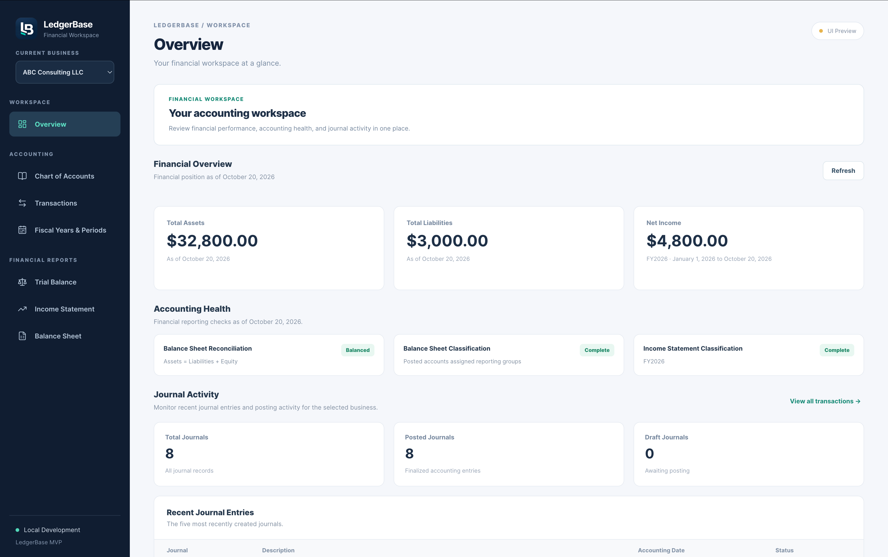
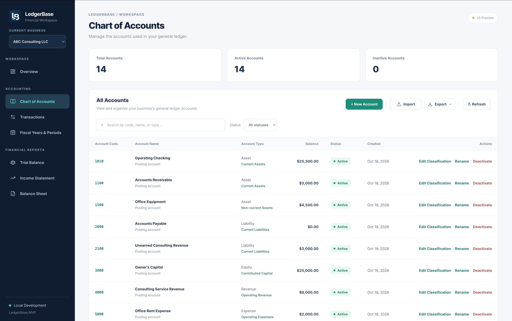
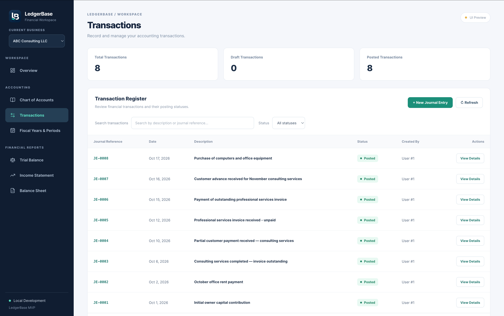
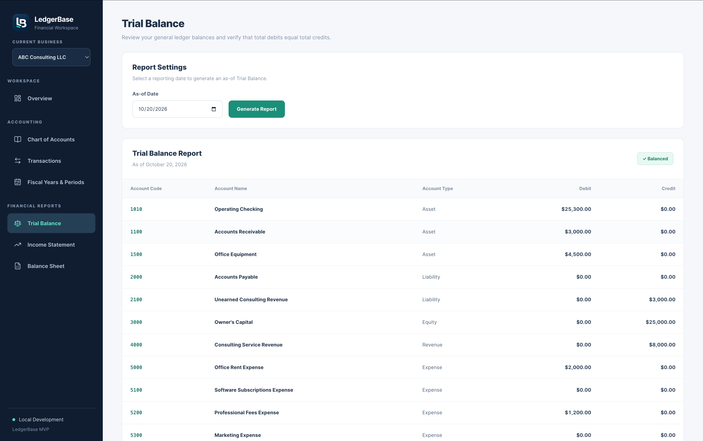
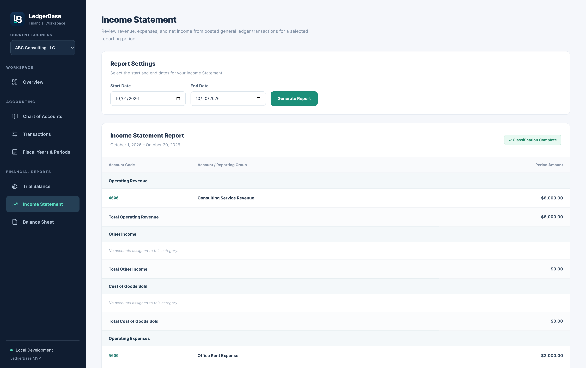
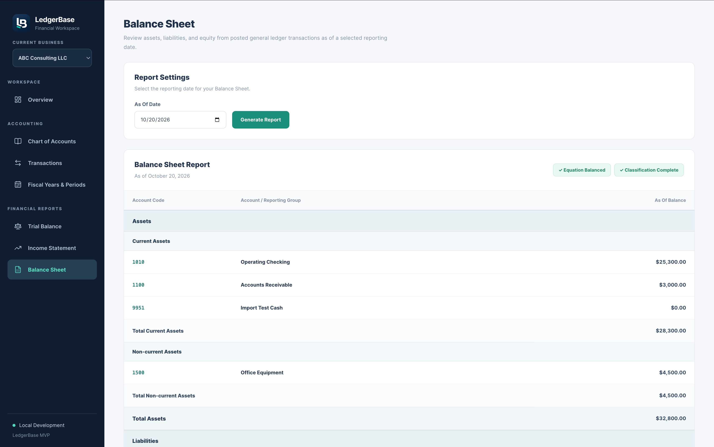

# LedgerBase

**Distributed Financial Accounting Platform | Java 25 · Spring Boot · PostgreSQL 17 · React · Redis · Kafka · Kubernetes**

LedgerBase is a backend-focused, full-stack financial accounting application that supports double-entry bookkeeping, general ledger management, draft-to-posted journal workflows, and financial reporting. It combines a React/TypeScript accounting workspace with Spring Cloud microservices and PostgreSQL-backed financial integrity controls.

The engineering platform demonstrates:

- **Microservices:** Spring Cloud Gateway routes accounting operations to Accounting Core and Trial Balance requests to an independent Reporting Service.
- **Security:** JWT authentication, session validation, and business-scoped OWNER/VIEWER role-based access control (RBAC).
- **Data consistency:** PostgreSQL ACID transactions, integrity constraints, protected posted records, and Flyway migrations.
- **Read/write separation:** PostgreSQL 17 primary with WAL streaming read replica for Trial Balance reporting.
- **Caching:** Six-node Redis Cluster (three primaries and three replicas) with business-, date-, and revision-aware Trial Balance cache keys.
- **Asynchronous events:** Kafka transactional outbox and PostgreSQL idempotent consumer inbox using at-least-once delivery semantics.
- **Infrastructure:** Docker, local kind Kubernetes deployment, GitHub Actions CI, Prometheus, and Grafana.

### Verified engineering results

| Verification | Result |
|---|---:|
| Mean response latency reduction with Redis enabled | **36.61%** |
| p95 response latency reduction with Redis enabled | **18.77%** |
| Measured PostgreSQL replica connection acquisition reduction | **95.29%** |
| Final Kubernetes hardening PR checks | **16/16 passed** |
| Browser accounting workflow checks | **7/7 passed** |
| PostgreSQL outbox events marked `PUBLISHED` | **1,007 / 1,007** |

The performance figures come from a **controlled local k6 benchmark**, not live production traffic. Connection acquisitions are not a direct measurement of total database load. LedgerBase is a portfolio application, **not production-certified accounting software**.

---

## Screenshots & Demo

LedgerBase provides a React-based accounting workspace for managing financial records, posting journal entries, and generating financial statements. The screenshots use the fictional business **ABC Consulting LLC** and its October 2026 accounting transactions.

### Financial Dashboard

The Overview dashboard displays financial performance, accounting health indicators, and recent journal activity using backend-derived data.



### Accounting Workflows

| Chart of Accounts | Journal Transactions |
|---|---|
|  |  |
| Account hierarchy, classifications, and CSV/XLSX import/export. | Business-specific references, draft/posted statuses, and double-entry workflows. |

### Financial Reporting

LedgerBase generates a Trial Balance, Income Statement, and Balance Sheet from posted ledger entries.

<details>
<summary><strong>View Financial Report Screenshots</strong></summary>

#### Trial Balance



#### Income Statement



#### Balance Sheet



</details>

### Accounting Demonstration

The ABC Consulting LLC scenario documents eight posted journal entries covering capital contributions, expenses, revenue recognition, receivables, payables, customer advances, and fixed-asset purchases. It verifies $4,800.00 net income, $32,800.00 total assets, and a $0.00 Balance Sheet reconciliation difference.

**[View the Complete Accounting Demonstration](docs/accounting-demo.md)**

The demonstration data lives in a local development database; cloning the repository does not automatically seed these entries.

---

## Tech Stack

| Layer | Technologies |
|---|---|
| Frontend | React, TypeScript, Vite, Axios |
| Backend | Java 25, Spring Boot, Spring Cloud Gateway, REST APIs |
| Database access | MyBatis, Spring JDBC |
| Primary database | PostgreSQL 17 |
| Replication | PostgreSQL WAL streaming replication |
| Schema migrations | Flyway |
| Caching | Redis Cluster, Spring Data Redis, Lettuce |
| Messaging | Apache Kafka, transactional outbox, idempotent inbox |
| Security | JWT, session validation, business-scoped RBAC |
| Containers and orchestration | Docker, Docker Compose, Kubernetes (kind), Docker Buildx |
| CI | GitHub Actions, automated tests/builds, Kubernetes manifest validation |
| Observability | Prometheus, Grafana, Spring Boot Actuator, Micrometer |
| Build and testing | Maven, npm, JUnit, Mockito, Spring Boot integration tests, k6 benchmarks |

---

## Architecture

For the detailed design, see the [System Architecture Guide](docs/architecture.md).

```text
React + TypeScript (Nginx in Kubernetes)
                  |
                  v
         Spring Cloud Gateway
                :8081
                  |
       +----------+----------+
       |                     |
       v                     v
 Accounting Core       Reporting Service
     :8080                  :8082
       |                     | \
       |                     |  +--> Redis Cluster (6 nodes)
       |                     v
       |             PostgreSQL Read Replica
       |                     ^
       v                     |
 PostgreSQL Primary ---------+
       |
       v
 Transactional Outbox
       |
       v
 Kafka Publisher --> Kafka Broker --> Kafka Consumer
                                        |
                                        v
                                 PostgreSQL Inbox
```

**Accounting Core** is authoritative for financial writes, transaction posting, and account integrity. **Reporting Service** handles Trial Balance queries using the read replica and Redis cache. Reporting Service also validates authentication and business access through Accounting Core.

### Frontend

The React workspace supports business selection, account management, journal creation and review, posting confirmation, report presentation, and loading/error/success states. It uses REST APIs through Spring Cloud Gateway and displays backend-computed financial values rather than performing floating-point accounting calculations in the browser.

### Backend and database

Spring Boot services enforce journal balance, account eligibility, business ownership, transaction lifecycle rules, and posted-record immutability. PostgreSQL stores financial records with business-scoped relationships, foreign keys, auditing, business-specific journal numbering, and transactional integrity. Flyway manages versioned schema changes; MyBatis maps Java operations to SQL.

---

## Kafka Transactional Outbox and Idempotent Consumer

Kafka supports asynchronous financial event processing without making successful ledger posting dependent on immediate broker availability.

### Event flow

1. Accounting Core validates and posts a balanced draft transaction.
2. A PostgreSQL transaction atomically persists the posting, audit information, reporting revision, and outbox event.
3. The outbox publisher claims committed events with `FOR UPDATE SKIP LOCKED`.
4. It publishes `TransactionPosted` events to Kafka.
5. After Kafka acknowledges publication, the publisher marks the outbox event `PUBLISHED`.
6. The consumer validates the event and records a processing receipt in PostgreSQL.
7. The consumer acknowledges Kafka after the inbox transaction commits.

### Delivery and idempotency

Delivery is **at least once**, not globally exactly once. Failed publication attempts are retried with backoff; expired claims can be recovered. The inbox uses a unique `(consumer_name, event_id)` constraint to avoid duplicate database processing by the same logical consumer. The consumer does not repost financial transactions or modify authoritative ledger balances.

Automated tests cover posting/outbox atomicity, rollback on outbox insertion failure, duplicate prevention, publisher acknowledgments and retries, expired-claim recovery, consumer deduplication, processing failure behavior, and rejection of events referencing draft transactions. Manual testing also verified retries when Kafka was unavailable and publication after recovery.

### Local Kafka setup (Docker Compose)

```bash
docker compose -f docker-compose.yml -f docker-compose.kafka.yml up -d kafka
```

If the financial event topic does not exist, create it:

```bash
docker exec ledgerbase-kafka \
  /opt/kafka/bin/kafka-topics.sh \
  --bootstrap-server localhost:19092 \
  --create --if-not-exists \
  --topic ledgerbase.transaction-posted.v1 \
  --partitions 3 --replication-factor 1
```

For the local Maven-run Accounting Core, enable the Kafka outbox profile when its infrastructure and configuration are available:

```bash
mvn -f backend/pom.xml spring-boot:run \
  -Dspring-boot.run.profiles=kafka-outbox
```

Kafka publishing/consumption is opt-in in local application profiles and disabled for normal backend test runs.

### Runtime verification — November 9, 2026

- PostgreSQL reported **1,007 outbox events** with status `PUBLISHED`, each with a non-null publication timestamp.
- The `ledgerbase.transaction-posted.v1` topic contained retained `TransactionPosted` events.
- The browser smoke-test transaction (`transaction_id = 1007`) had outbox status `PUBLISHED`, `attempt_count = 1`, and a matching `PROCESSED` consumer inbox record.
- The corresponding database timestamps were approximately **47 ms apart**. This is a timestamp difference, **not** an independently benchmarked end-to-end Kafka latency.

### Development limitations

The local broker uses single-node KRaft, replication factor 1, and PLAINTEXT listeners. Production deployment would require broker redundancy, authentication and TLS, operational alerting, appropriate handling of permanently failing messages, and disaster recovery. The consumer retry policy can block a partition on an unprocessable record. Kafka's `earliest` offset reset applies when a consumer group has no previously committed offsets.

---

## Implemented Features

### 1. Business and accounting structure

Business-scoped financial data includes businesses, fiscal years, accounting periods, general ledger accounts, transactions, debit/credit ledger entries, and reporting classifications. JWT and business-scoped OWNER/VIEWER RBAC restrict authorized operations.

### 2. Chart of Accounts

- Create accounts with business-specific account codes and classify them as Asset, Liability, Equity, Revenue, or Expense.
- Organize accounts into reporting groups and parent–child hierarchies; grouping accounts may be non-postable.
- Search, filter, update supported fields, and deactivate accounts while preserving financial history.
- Display account statistics and operation feedback.

### 3. Double-entry transaction processing

- Create draft journal entries with multiple debit/credit lines.
- Validate equal debit and credit totals, account eligibility, and business ownership.
- Review transaction details and post valid drafts.
- Enforce immutable posted records with backend rules and database safeguards.
- Record supported operation audit information.

```text
CREATE JOURNAL ENTRY --> DRAFT --> VALIDATE --> POSTED --> FINANCIAL REPORTS
```

### 4. Business-specific journal references

Journal references are independently numbered per business (for example, Business A `JE-0001`, `JE-0002`; Business B `JE-0001`). PostgreSQL assigns references at creation; internal transaction IDs remain distinct from human-readable references. The React UI shows references in registers, detail panels, and notifications.

### 5. Financial reporting

- **Trial Balance:** aggregates posted entries and checks debit/credit equality.
- **Income Statement:** aggregates revenue and expenses by reporting period and computes net income or loss.
- **Balance Sheet:** aggregates assets, liabilities, equity, and unclosed earnings; checks `Assets = Liabilities + Equity`.

Draft entries are excluded from posted financial balances.

### 6. React accounting interface

Business selection, account register, journal transaction register, search/status filters, journal form with debit/credit validation, transaction detail view, posting confirmation, financial reports, and contextual loading/error/success feedback. Values originate from backend APIs, not invented frontend balances.

### 7. Accounting data integrity

Application validation and PostgreSQL constraints protect double-entry balance, transaction lifecycle, foreign keys, business ownership, immutable posted records, transactional operations, auditing, and journal reference assignment.

### 8. Chart of Accounts CSV/XLSX import and export

- Export business account definitions in `.csv` or `.xlsx` with classifications, groups, and hierarchy.
- Upload CSV/XLSX, parse rows, and preview validation results before committing.
- Report row-specific errors, prevent duplicate codes, and resolve parent relationships independent of input ordering.
- Import accounts transactionally, rolling back on failure, then refresh the account register.
- Only new account creation is supported by import; existing codes, including inactive ones, cannot be reused. Updating existing rows or skipping duplicates remains future work.

```text
Select File --> Parse --> Validate --> Preview --> Confirm --> Transactional Insert --> Refresh
```

### 9. Financial overview dashboard

The dashboard displays backend-derived total assets, liabilities, fiscal-year-to-date net income, reporting period, total/posted/draft journal counts, and five recent journals. It also surfaces Balance Sheet reconciliation and financial reporting classification warnings. Drafts do not contribute to posted balances.

---

## Accounting Demo

The fictional ABC Consulting LLC walkthrough covers eight October 2026 journal entries:

| Reference | Accounting scenario |
|---|---|
| JE-0001 | Initial owner capital contribution |
| JE-0002 | Office rent payment |
| JE-0003 | Consulting revenue earned on credit |
| JE-0004 | Partial customer payment |
| JE-0005 | Unpaid professional services expense |
| JE-0006 | Payment of outstanding vendor liability |
| JE-0007 | Customer advance and unearned revenue |
| JE-0008 | Office equipment purchase |

### Verified demo results

| Financial metric | Result |
|---|---:|
| Posted journal entries | 8 |
| Trial Balance debits | $36,000.00 |
| Trial Balance credits | $36,000.00 |
| Total revenue | $8,000.00 |
| Total expenses | $3,200.00 |
| Net income | $4,800.00 |
| Total assets | $32,800.00 |
| Total liabilities | $3,000.00 |
| Total equity | $29,800.00 |
| Balance Sheet difference | $0.00 |

All eight entries were checked as posted and balanced in the local development database. See the [Accounting Demo Guide](docs/accounting-demo.md) for the manual reproduction steps. **The demo is documented, not automatically seeded on clone.**

---

## Performance Benchmarking

Redis Cluster caches Trial Balance results while PostgreSQL remains the authoritative source of accounting data. Cache keys include the business, report date, and reporting revision, avoiding reuse of prior-revision reports after relevant ledger changes.

### Benchmark design

- A reproducible local dataset of **1,000 posted transactions** and **2,000 ledger entries**.
- **Three paired k6 runs** comparing Redis caching enabled and disabled.
- Equivalent reporting workloads in the two configurations.

### Measured outcomes

| Metric | Measured reduction with caching enabled |
|---|---:|
| Mean response latency | **36.61%** |
| p95 response latency | **18.77%** |
| PostgreSQL replica connection acquisitions | **95.29%** |

Results apply to this controlled workload and environment; they do not establish production throughput, overall database load reduction, or high-availability performance. Refer to the repository's benchmark scripts and retained benchmark output for reproduction and measurement details.

### Cache correctness smoke test — November 9, 2026

The authenticated Trial Balance API returned HTTP 200 for business 1 at `asOfDate=2026-11-08`. Redis contained the revision-aware key:

```text
ledgerbase:report:trial-balance:v1:{business-1}:2026-11-08:rev-4
```

The entry had a positive TTL (**195 seconds remaining** when inspected). After repeating the same report request twice, the matching Redis primary's `keyspace_hits` counter increased **61 → 63**, while `keyspace_misses` remained **3**. This corroborates cache reuse during the test; Redis counters are node-wide and are not isolated per API request.

---

## Project Structure

```text
LedgerBase/
├── backend/
│   ├── src/main/java/
│   ├── src/main/resources/db/migration/
│   ├── src/main/resources/mapper/
│   ├── src/test/
│   ├── mvnw
│   └── pom.xml
├── frontend/
│   ├── src/
│   ├── Dockerfile
│   ├── nginx.conf
│   └── package.json
├── reporting-service/
├── gateway/
├── k8s/
│   ├── base/
│   └── kind/
├── docs/
│   ├── accounting-demo.md
│   ├── architecture.md
│   ├── kubernetes-deployment.md
│   └── screenshots/
├── .github/workflows/
├── docker-compose.yml
└── README.md
```

The repository also contains supporting Compose configurations, infrastructure scripts, benchmark tooling, and monitoring configuration.

---

## Getting Started

### Prerequisites

- Java 25 (for running the Spring Boot applications locally)
- Node.js and npm (for frontend development)
- Docker Desktop with Docker Compose
- Git
- For Kubernetes deployment: `kubectl`, `kind`, and the requirements in the [Kubernetes Deployment Guide](docs/kubernetes-deployment.md)

A Maven Wrapper is included, so a global Maven installation is not required.

### 1. Clone the repository

```bash
git clone https://github.com/angel-az41/LedgerBase.git
cd LedgerBase
```

### 2. Configure the local environment

If `.env` does not already exist, create it from the example and replace placeholder credentials:

```bash
cp .env.example .env
```

Do not overwrite an existing working `.env`. The default Docker Compose database is PostgreSQL 17, database `ledgerbase`, user `ledgerbase`, host port `5434`, container port `5432`, with the password supplied through `POSTGRES_PASSWORD`.

The Compose PostgreSQL service and the Spring Boot database configuration must use matching credentials. **Changing `.env` after the persistent PostgreSQL volume is initialized does not automatically change the database user's password.** Do not delete the data volume simply to change a password. Never commit `.env` or real secrets to Git.

### 3. Start PostgreSQL for local development

```bash
docker compose up -d
docker compose ps
```

The Compose development database is distinct from the PostgreSQL primary/replica deployed inside Kubernetes. Follow the Kubernetes guide rather than mixing the two procedures.

### 4. Start the backend services locally

| Service | Default development port | Responsibility |
|---|---:|---|
| Accounting Core | 8080 | Financial writes, JWT/RBAC, PostgreSQL transactions, Kafka event processing |
| Reporting Service | 8082 | Trial Balance, replica read queries, Redis caching |
| Spring Cloud Gateway | 8081 | Public API routing |

Start the services in separate terminal sessions using their respective Maven configuration, **after** configuring any required PostgreSQL replica, Redis, and Kafka dependencies for the selected application profiles. Flyway applies the configured schema migrations. See [System Architecture](docs/architecture.md) for the service responsibilities and [Kubernetes Deployment](docs/kubernetes-deployment.md) for the full containerized stack.

### 5. Start the frontend locally

```bash
cd frontend
npm install
npm run dev
```

Open `http://localhost:5173`. In development, Vite proxies `/api` requests to Spring Cloud Gateway on port `8081`.

### 6. Explore the accounting workflows

Sign in with a configured development account, select a business, review accounts, create and post a balanced draft, then inspect Trial Balance, Income Statement, and Balance Sheet. A fresh environment may require initial business and account setup. For a reproducible manual accounting scenario, follow the [Accounting Demo Guide](docs/accounting-demo.md).

---

## Local Kubernetes Deployment

LedgerBase is deployable to a **single-node local kind cluster** with Accounting Core, Reporting Service, Gateway, React/Nginx, PostgreSQL primary and read replica, Redis Cluster, Kafka, Prometheus, and Grafana.

### Local access

| Service | Local address |
|---|---|
| LedgerBase frontend | http://localhost:3001 |
| Prometheus | http://localhost:19090 |
| Grafana | http://localhost:13000 |

Prometheus and Grafana require the port-forwarding steps described in the [Kubernetes Deployment Guide](docs/kubernetes-deployment.md). Local port mappings depend on the documented kind cluster configuration.

### Verified runtime — November 9, 2026

- **6/6 Deployments** available and **4/4 StatefulSets** ready.
- **6/6 Redis Pods** running; all running Pods reported **zero restarts**.
- React/Nginx frontend responded **HTTP 200** at `http://localhost:3001`.
- PostgreSQL WAL replication reconnected after a primary rollout; the physical replication slot was active and WAL streaming resumed.
- Kafka outbox publication and matching consumer inbox processing passed for transaction 1007.
- Redis Cluster had its hash slots assigned; a revision-aware cached Trial Balance entry existed with a positive TTL, and two repeat report requests were associated with two additional cache hits.

### Accounting browser smoke test

All **7/7** checks passed: authentication, Dashboard and Chart of Accounts access, balanced draft creation, posting, posted-record immutability, Trial Balance reconciliation, and Income Statement/Balance Sheet loading.

### Local reliability and security safeguards

Kubernetes manifests disable automatic service-account-token mounting on the PostgreSQL primary and use dedicated readiness/liveness endpoints for Reporting Service. GitHub Actions validates manifests and builds/test artifacts; the frontend Dockerfile uses Buildx's native `BUILDPLATFORM` for compilation while retaining AMD64/ARM64 Nginx runtime support.

See the [Kubernetes Deployment Guide](docs/kubernetes-deployment.md) for provisioning, verification, monitoring, and troubleshooting. **The kind deployment demonstrates orchestration and integration, not production-grade high availability.**

---

## Testing and Continuous Integration

### Backend tests

Automated tests cover REST APIs, accounting operations, rollback and constraints, financial reporting, and asynchronous event reliability. Development and integration testing use separate PostgreSQL databases:

| Database | Purpose |
|---|---|
| `ledgerbase` | Local development/demo records |
| `ledgerbase_test` | Automated integration tests |

Check `backend/src/test/resources/application-test.yaml` to confirm the `test` profile uses `ledgerbase_test`. Integration tests may modify or delete data in the test database; **never aim them at the demo database**.

For a fresh Compose PostgreSQL installation, initialize the test database if it does not exist:

```bash
docker exec ledgerbase-postgres \
  psql -U ledgerbase -d postgres \
  -c "CREATE DATABASE ledgerbase_test;"
```

After confirming the test database and credentials:

```bash
set -a
source .env
set +a
cd backend
./mvnw clean verify
```

### Frontend production build

```bash
cd frontend
npm run build
```

### GitHub Actions CI

CI runs automated backend/service tests, frontend production builds, Kubernetes/Grafana and manifest validation, and multi-architecture Docker image builds. The final Kubernetes hardening PR passed **16/16 checks** across its push and pull-request workflows.

The Docker frontend build compiles React/Vite on the builder's native CPU architecture and packages the static output into architecture-specific Nginx images. This resolved a previously timed-out QEMU-emulated ARM64 npm install without disabling ARM64 support.

**CI is implemented; fully automated production deployment is not claimed.**

### Manual end-to-end validation

The ABC Consulting LLC demonstration checks business journal references, posting lifecycle, balance integrity, receivables, payables, unearned revenue, fixed-asset accounting, and financial statements. The November 9 kind smoke test additionally verified the authenticated UI workflow, Kafka publication/consumption, and Redis Trial Balance cache reuse.

---

## Planned Enhancements

The following are future possibilities, not current release functionality:

### Accounting and data migration

- Import external journal transactions and customer/vendor records.
- Support opening-balance migration and reconciliation tools.
- Add validated updates and skip-existing modes to account imports.
- Add invoices, bills, payment allocation, reversals, depreciation, and richer financial reporting.

### Distributed systems and operations

- Automated deployment pipelines (CD) beyond the existing CI validation.
- Distributed tracing, actionable alerts, and extended concurrency/failure recovery coverage.
- Secure Kafka communications, dead-letter handling, and operational runbooks.
- Multi-node Kubernetes deployment, autoscaling, automated backups, and disaster recovery.

---

## Development Status and Release Scope

LedgerBase has completed its core accounting workflows, microservice separation, PostgreSQL replication, Redis caching, Kafka event processing, local Kubernetes deployment, monitoring, automated CI validation, controlled performance benchmarking, and final end-to-end smoke test.

The project is in **final documentation and release preparation**. The original accounting application milestone was released as `v1.0.0` on October 20, 2026; subsequent distributed infrastructure work is being prepared for a new release checkpoint.

### Important limitations

LedgerBase is a development and portfolio application, not production-certified accounting software. Production deployment would require, among other controls:

- Production-grade secret management, key rotation, and infrastructure TLS/authentication.
- Multi-broker Kafka availability and secure message transport.
- Database backup, restore verification, disaster recovery, and documented RPO/RTO objectives.
- High availability across multiple Kubernetes nodes and operational failure testing.
- Production monitoring/alerting, tracing, and permanent Kafka failure handling.
- Security review, compliance assessment, and additional financial-system controls.

The local Kafka deployment uses a single broker with PLAINTEXT listeners, and the kind cluster is single-node. Neither setup is intended to provide production high availability.
