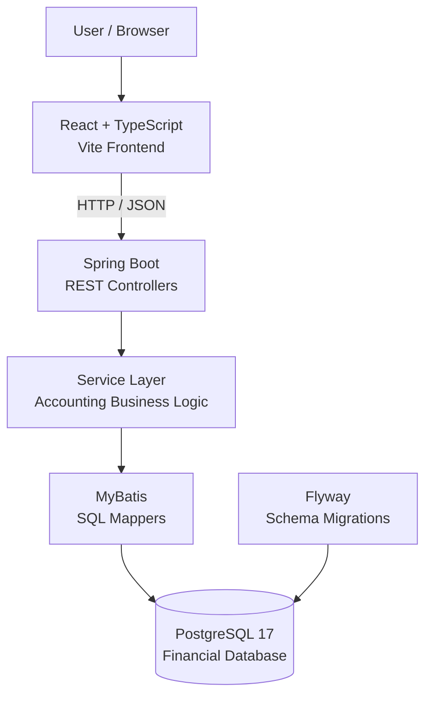
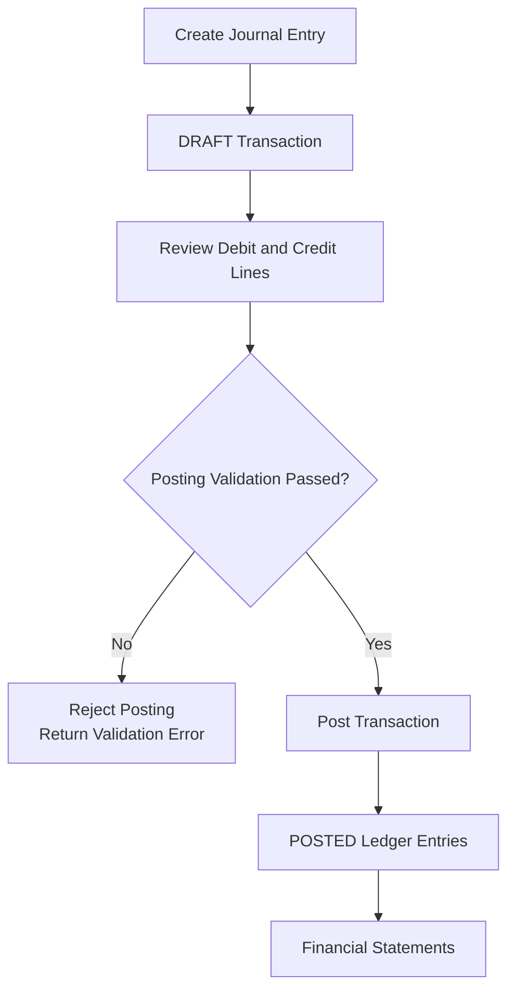

# LedgerBase — System Architecture

## 1. Overview

LedgerBase is a full-stack financial accounting application
built using React, TypeScript, Java, Spring Boot, MyBatis,
and PostgreSQL.

The system follows a layered architecture that separates:

- User interface and presentation logic.
- HTTP API request handling.
- Accounting business rules.
- Database access and SQL operations.
- Persistent financial records.

This separation helps keep accounting calculations,
validation, and database operations independent of the
frontend implementation.

---

## 2. System Architecture Diagram

### Technology responsibilities

| Layer | Technology | Responsibility |
|---|---|---|
| Presentation | React, TypeScript | User workflows and financial data display |
| API | Spring Boot | HTTP request and response handling |
| Business logic | Java services | Accounting validation and processing |
| Data access | MyBatis | SQL execution and object mapping |
| Persistence | PostgreSQL | Financial records, integrity constraints, and transactions |
| Migrations | Flyway | Version-controlled database schema |
| Local environment | Docker Compose | PostgreSQL container management |

---

## 3. Frontend Architecture

The frontend uses React and TypeScript with Vite.

Its primary responsibilities include:

- Selecting the active business.
- Managing Chart of Accounts records.
- Creating and reviewing journal entries.
- Initiating transaction posting.
- Displaying financial statements.
- Importing and exporting account definitions.
- Presenting financial dashboard metrics.
- Handling loading states and API errors.

API clients are organized separately from page components
under `frontend/src/api/`.

Financial balances are not independently recalculated in
the browser.

Instead, the frontend displays the values returned by
backend financial reporting services.

This avoids duplicating authoritative accounting logic
across application layers.

---

## 4. Backend Architecture

Spring Boot provides the REST API and coordinates
LedgerBase's accounting operations.

### Controller layer

Controllers expose HTTP endpoints and coordinate
request validation and responses.

### Service layer

Services implement business workflows, including:

- Account management.
- Journal entry validation.
- Transaction posting.
- Fiscal year and accounting period rules.
- Financial reporting.
- Chart of Accounts import processing.

### Data access layer

MyBatis mappers execute SQL against PostgreSQL.

They separate database operations from higher-level
accounting workflows.

### Database layer

PostgreSQL persists businesses, accounts, transactions,
ledger entries, and related accounting structures.

The database uses relational constraints and supported
database-level protections to preserve financial integrity.

---

## 5. Double-Entry Accounting Workflow

LedgerBase separates draft creation from posting.

The accounting workflow validates that:

- Debit and credit totals are equal.
- Referenced accounts belong to the correct business.
- Accounts are eligible for posting.
- Transaction state transitions are valid.
- Applicable fiscal and accounting period rules are met.

Posted ledger entries contribute to financial reports.

Draft entries do not affect posted financial balances.

Database transactions and additional safeguards protect
the consistency of supported accounting operations.

---

## 6. Business Data Isolation

Financial records are associated with a business.

The application uses business-scoped operations to
separate accounting information for different businesses.

For example, journal references are generated within
each business rather than using a single global
display sequence.

Business-scoped data relationships provide structural
separation but do not replace authentication or
authorization.

Production-grade access controls are planned for a
future version.

---

## 7. Financial Reporting Architecture

LedgerBase currently supports:

- Trial Balance.
- Income Statement.
- Balance Sheet.

These reports aggregate posted accounting records
stored in PostgreSQL.

### Trial Balance

Aggregates account debit and credit balances and
checks the equality of total debits and credits.

### Income Statement

Aggregates revenue and expense accounts over the
applicable reporting period to calculate net income.

### Balance Sheet

Aggregates assets, liabilities, and equity at a
reporting date, including the appropriate treatment
of unclosed earnings.

Reporting classifications determine how general
ledger accounts contribute to financial statements.

The frontend presents backend-generated report values
without independently reconstructing the ledger.

---

## 8. Financial Dashboard

The Overview dashboard combines two data sources.

### Financial metrics

The dashboard obtains financial values using the
existing backend financial reporting APIs.

These include:

- Total Assets.
- Total Liabilities.
- Fiscal-year-to-date Net Income.
- Accounting reconciliation and classification checks.

### Journal activity

The frontend retrieves the business's transaction
records from the existing transaction API.

It derives:

- Total journal count.
- Posted journal count.
- Draft journal count.
- Five most recently created journal entries.

Journal activity counts are distinct from financial
statement calculations.

For the current MVP, the activity summary uses the
existing transaction-list API.

A dedicated server-side aggregate or paginated
endpoint may be introduced for larger datasets.

---

## 9. Chart of Accounts Import and Export

LedgerBase supports CSV and Excel (`.xlsx`) account
import and export.

### Import workflow

1. The user selects a supported file.
2. The backend parses the account data.
3. Validation identifies invalid and duplicate records.
4. The frontend displays a preview and validation results.
5. The user confirms the import.
6. Validated accounts are inserted transactionally.
7. The frontend refreshes the Chart of Accounts.

The import process supports account hierarchy
relationships and non-postable grouping accounts.

Transactional import prevents a failed import from
leaving a partially inserted account batch.

### Export workflow

The backend retrieves business-specific account data
and generates the requested CSV or Excel file.

Exported data comes from persisted database records.

---

## 10. Database Migrations

Flyway manages version-controlled PostgreSQL schema
changes.

Migration scripts are stored in:

`backend/src/main/resources/db/migration/`

The migrations establish and evolve the database schema,
including accounting tables, relationships, constraints,
and supporting database objects.

On application startup, Flyway applies outstanding
migrations according to its configured migration policy.

---

## 11. Local Development Environment

The local development architecture uses:

| Component | Local address |
|---|---|
| React/Vite | `http://localhost:5173` |
| Spring Boot | `http://localhost:8080` |
| PostgreSQL | `127.0.0.1:5434` |

Vite proxies local API requests to Spring Boot.

Docker Compose manages the PostgreSQL container.

The repository provides `.env.example` as a safe
configuration template.

Database passwords must remain outside Git.

---

## 12. Testing Architecture

LedgerBase uses separate PostgreSQL databases for
development and integration testing.

| Database | Purpose |
|---|---|
| `ledgerbase` | Local development |
| `ledgerbase_test` | Automated integration tests |

The Spring Boot test configuration is stored in:

`backend/src/test/resources/application-test.yaml`

Automated testing covers supported accounting workflows,
REST APIs, database behavior, transaction rollback,
concurrency scenarios, and financial reporting.

The documented ABC Consulting LLC accounting demo
provides an additional manual end-to-end validation
scenario.

---

## 13. Current Limitations

LedgerBase v1.0 is a portfolio and development application,
not production-ready accounting software.

Current limitations include:

- No production authentication or complete authorization.
- Development use of a temporary demo identity.
- No automatically seeded accounting demo dataset.
- No deployed distributed caching or event platform.
- No production-grade operational security controls.

Future engineering work may introduce Spring Security,
RBAC, Redis, Kafka, transactional outbox processing,
Kubernetes, observability, and performance testing.

These technologies are not part of the current
implemented architecture.
