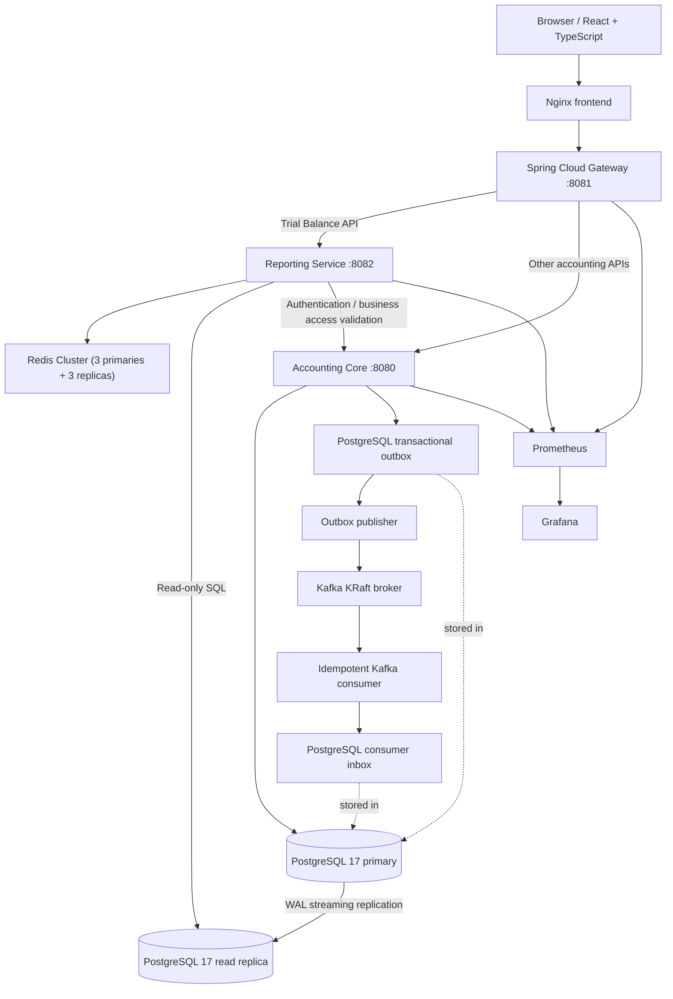
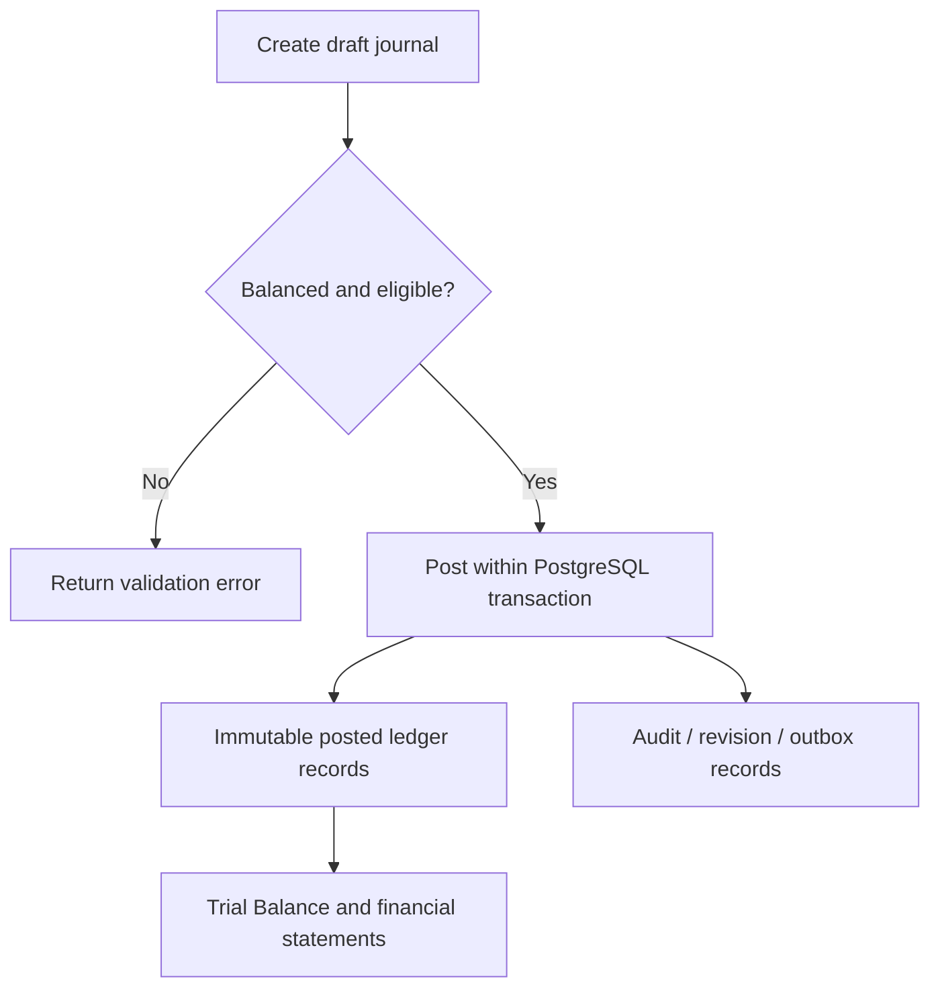
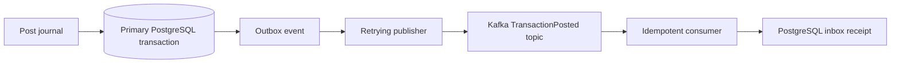

# LedgerBase — System Architecture

## 1. Overview

LedgerBase is a backend-focused financial accounting platform built with Java 25, Spring Boot, Spring Cloud Gateway, MyBatis, PostgreSQL 17, React, and TypeScript. It combines double-entry accounting workflows with a locally deployed distributed architecture for reporting, caching, asynchronous events, monitoring, and CI validation.

The authoritative accounting records live in PostgreSQL. Supporting services improve read separation and responsiveness without becoming alternative sources of financial truth.

**Scope:** The architecture below describes the implemented local Docker/kind environment. It is not a production high-availability or compliance-certified financial system.

## 2. Deployed Architecture



The diagram shows logical flows. The outbox and inbox are PostgreSQL tables on the primary, not independent datastores. The Reporting Service's database queries target a restricted, read-only connection to the replica. Other accounting endpoints remain owned by Accounting Core, including authoritative financial writes and the existing financial statement APIs.

### Service responsibilities

| Component | Responsibility |
|---|---|
| React + TypeScript / Nginx | Accounting user experience, client-side input validation, and static asset serving |
| Spring Cloud Gateway | Single API entry point; routes Trial Balance reporting to Reporting Service and other accounting APIs to Accounting Core |
| Accounting Core | Authentication, business-scoped authorization, journal posting, accounting rules, SQL writes, outbox publisher, and Kafka consumer |
| Reporting Service | Trial Balance reporting, replica-backed reads, and revision-aware Redis caching |
| PostgreSQL primary | Authoritative ledger, business records, sessions, reporting revisions, and event outbox/inbox |
| PostgreSQL replica | Asynchronous WAL-streamed read-only copy used by reporting |
| Redis Cluster | Distributed cache for report results; not authoritative financial storage |
| Kafka | Asynchronous `TransactionPosted` event delivery |
| Prometheus / Grafana | Service metrics collection and operational dashboards |

## 3. Accounting Domain and Data Integrity

LedgerBase implements business-scoped accounts, fiscal years, accounting periods, journal transactions, and debit/credit ledger entries. The chart of accounts supports hierarchy, reporting classifications, and CSV/XLSX import/export.

A journal entry begins as `DRAFT`. Posting requires balanced debit/credit totals, eligible accounts in the same business, and valid state and accounting-period rules. Posted transactions are protected from edits. Financial statements aggregate applicable **posted** entries rather than drafts.



PostgreSQL transactions, constraints, business-scoped relationships, and applicable database protections reinforce backend validation. Business-specific journal references are separate from internal transaction IDs.

## 4. Authentication and Authorization

Accounting Core implements JWT-based authentication and business-scoped role-based access control (RBAC). Business membership roles include `OWNER` and `VIEWER`. Owners may perform supported write operations; viewers receive read-only access to the relevant accounting workflows. The React UI reflects permissions, but the backend is the authority for access control.

JWT validation includes issuer/audience and session checks against PostgreSQL authentication records. Reporting Service validates authentication and business access through Accounting Core. Business-scoped database relationships provide data organization but do not substitute for authorization.

This is an implemented development security model, not a claim of production-grade identity management, compliance certification, or complete infrastructure hardening.

## 5. PostgreSQL Primary–Replica Architecture

Financial writes execute against the PostgreSQL 17 primary under transactional guarantees. WAL streaming replication maintains an asynchronous physical standby. Reporting Service uses a separate, restricted reader credential and HikariCP datasource to execute supported Trial Balance queries against the replica.

**Consistency tradeoff:** The replica may temporarily lag behind committed primary writes. The architecture does not guarantee synchronous read-after-write consistency for replica-backed reporting. Cache revision checks reduce stale-cache reuse but do not eliminate replication lag.

The local deployment uses a physical replication slot. A successful primary Pod restart and subsequent replica reconnection were verified during Kubernetes hardening.

## 6. Revision-Aware Redis Cluster Caching

Reporting Service uses Spring Data Redis / Lettuce with a six-node Redis Cluster (three primaries, three replicas). Trial Balance cache entries are scoped by business, reporting date, and financial revision. A representative key observed during the final smoke test was:

```text
ledgerbase:report:trial-balance:v1:{business-1}:2026-11-08:rev-4
```

A relevant financial posting advances the reporting revision, causing subsequent requests to use a different cache key. Cache entries also expire according to their TTL. When Redis is unavailable, the reporting path is designed to fall back to PostgreSQL rather than treating Redis as the authoritative source.

The November 9, 2026 smoke test confirmed an existing cache entry with a positive TTL and **two additional Redis hits** after repeated identical Trial Balance requests; the miss counter did not increase during that comparison.

## 7. Kafka Transactional Outbox and Idempotent Inbox

Kafka decouples committed financial posting from downstream event processing. The accounting transaction and its outbox record are committed atomically in PostgreSQL. A publisher claims pending records using `FOR UPDATE SKIP LOCKED`, publishes a `TransactionPosted` event, and records successful broker acknowledgment. Retry and expired-lease recovery handle transient publisher failures.

The consumer records event-processing receipts in a PostgreSQL inbox with uniqueness scoped by consumer and event ID. It acknowledges Kafka after database processing commits, enabling at-least-once delivery with idempotent database effects. It does **not** repost the original financial transaction or independently alter authoritative balances.



**Runtime evidence (November 9, 2026):** All **1,007** current outbox records had status `PUBLISHED` and a publication timestamp. Transaction `1007` was published on its first attempt and had a matching `PROCESSED` inbox receipt. Duplicate-event handling and other failure cases were also exercised by automated tests. These checks establish the observed local workflow, not globally exactly-once delivery.

The local broker is a single Kafka KRaft node with replication factor 1, so it is not broker-fault-tolerant.

## 8. Financial Reporting and Dashboard

The application provides Trial Balance, Income Statement, and Balance Sheet reports. Trial Balance reads are routed through Reporting Service; existing other financial reporting APIs are handled through Accounting Core. The browser displays backend-computed balances and does not independently recompute the ledger.

The Dashboard presents assets, liabilities, fiscal-year-to-date net income, accounting-health indicators, and recent journal activity from backend data. Correctness depends on posted ledger entries, account classifications, and the applicable reporting date/period.

## 9. Deployment, Observability, and CI

The verified local Kubernetes deployment runs on kind and includes six Deployments (Accounting Core, Reporting Service, Gateway, frontend, Prometheus, Grafana) and four StatefulSets (PostgreSQL primary, PostgreSQL replica, Kafka, Redis Cluster). It uses persistent volume claims for stateful services.

Prometheus collects Micrometer/Actuator metrics from the Java services; Grafana provisions operational dashboards. Reporting Service uses dedicated Actuator readiness and liveness endpoints. Kubernetes security hardening includes disabling service-account-token automount for the PostgreSQL primary.

GitHub Actions CI covers Java tests, frontend production build, Kubernetes/Grafana validation, and Docker image builds. The frontend multi-platform Docker build compiles static assets on the native Buildx platform while packaging target-specific Nginx images for `linux/amd64` and `linux/arm64`.

During the final hardening PR, all **16/16 CI checks passed**. For operational setup, service ports, manifests, and troubleshooting, see [Local Kubernetes Deployment Guide](kubernetes-deployment.md) and [Docker Deployment Guide](docker-deployment.md).

## 10. Performance Evidence

A controlled local k6 benchmark used **1,000 posted transactions**, **2,000 ledger entries**, and **three paired Redis ON/OFF runs**. Measured improvements with Redis caching enabled were:

| Measure | Improvement |
|---|---:|
| Mean report response latency | 36.61% lower |
| p95 report response latency | 18.77% lower |
| PostgreSQL replica connection acquisitions | 95.29% lower |

These results apply to the measured local workload. Fewer connection acquisitions are **not** equivalent to a verified percentage reduction in database load or overall throughput. Benchmark reproduction details should be linked from the README to the actual script and evidence files in the repository.

## 11. End-to-End Verification

On November 9, 2026, the deployed local environment passed the following checks:

- Six of six Deployments available and four of four StatefulSets ready; all running application and infrastructure Pods had zero restarts in the checked snapshot.
- Frontend responded with HTTP 200.
- All seven browser accounting smoke tests passed: sign-in, account/dashboard access, draft creation, posting, posted-record immutability, Trial Balance reconciliation, and financial statement loading.
- Kafka outbox publication and a matching consumer inbox receipt were verified for test transaction `1007`.
- A live revision-aware Trial Balance cache entry with TTL was found; repeated identical requests produced two additional Redis cache hits with no new misses during that comparison.

This is a smoke test of a local application deployment, not a durability stress test, multi-node failover test, or audit of financial reporting compliance.

## 12. Local Development and Testing

Local development generally uses React/Vite (`localhost:5173`), Spring Cloud Gateway (`localhost:8081`), Accounting Core (`localhost:8080`), Reporting Service (`localhost:8082`), and Docker-managed PostgreSQL (`localhost:5434`). The exact services enabled depend on the selected Compose files and Spring profiles.

Automated integration tests use a separate PostgreSQL database, `ledgerbase_test`, to avoid modifying the ordinary demo database. Flyway migrations manage schema changes. See the root [README](../README.md) for setup and [Accounting Demo](accounting-demo.md) for the documented journal scenarios.

## 13. Limitations and Non-Goals

LedgerBase is a portfolio and local development application, not production-certified accounting software. Limitations include:

- Single-node kind cluster; no demonstrated multi-node resilience or autoscaling.
- Single Kafka broker and locally configured development listeners.
- Asynchronous PostgreSQL replication and no guaranteed zero-lag read-after-write consistency.
- No demonstrated off-cluster backup and disaster-recovery restore procedure.
- No demonstrated complete production secret rotation, internal TLS, network isolation, or alerting program.
- No demonstrated regulatory certification or production financial control/audit program.

The architecture intentionally prioritizes verifiable accounting correctness and realistic distributed-systems design over unsupported production availability claims.
